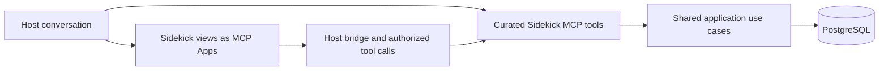

# MCP Apps as Sidekick's product frontend

Sidekick has no web frontend of its own. A compatible MCP host (Claude today) carries the conversation and
renders Sidekick's interactive views as MCP Apps. The Android app is a second surface for the same rooms
(D-075, [ADR-005](../../decisions/adr/ADR-005-native-android-app.md)); see the end of the next section. This
document describes the MCP Apps boundary: what the apps do, what the backend keeps, and what a view may and
may not ask of the host. The visual rules for the views are in
[the design system](../../reference/design-system.md).

## Responsibilities

The backend is a modular monolith. MCP tool handlers call application services directly and never
Sidekick's own HTTP API. Application services own transactions, authorization, ownership, versions and durable
idempotency. The apps own presentation only.

## One product UI, a narrow host boundary

MCP Apps associate a tool with a `ui://` HTML resource that the host renders in a sandbox; the app talks to the host through the
Apps bridge ([specification](https://github.com/modelcontextprotocol/ext-apps/blob/main/specification/2026-01-26/apps.mdx)).
This is an embedded web interface. Native installation and unrestricted device access are not part of the protocol.

- Product view code is shared across the app entry points (`frontend/src/features/*`, shell in
  `frontend/src/features/mcp-apps`). Domain behavior is owned by the server. Real host differences are isolated in
  the bridge lifecycle, capabilities, theme and locale, supported sizes, and approved link, file and user-message handoffs.
- A view may not call the network. Everything goes through the host bridge, and no backend credential is ever in the HTML.
- The Android app runs the same room components from assets packaged in the app, with no host bridge. A
  closed list of room calls is mapped to the companion routes under `/companion/v1/` (when
  `SIDEKICK_COMPANION_ENABLED=true`), which call the same use cases with paired, revocable device credentials.
  The rooms are therefore reachable over two transports, MCP and the companion adapter, and Work, Journal and Shopping
  are available through both.
- Another host (including a local one) is eligible only after its actual MCP Apps support is verified. Tool discovery alone
  is not evidence. A simulated test host is a test fixture, not a host.

## Entry, navigation and durable context

Existing focused read tools open the matching view where that is useful; structured output and concise text stay
available without UI support. The model sees a curated set of tools, not one tool per button.

Inside an app, navigation between lists, record details, related people and the journal works without a model round
trip per tap. Navigation uses a closed vocabulary (`frontend/src/features/mcp-apps/router.ts`, `nav-state.ts`): typed
record identity, an explicit back stack, and one root view per room. A view or entity identifier is only a hint: the
server re-resolves it through owner-filtered reads, unknown views and foreign IDs are refused safely, and no
route, HTML, script or executable intent ever comes from model text.

Rooms stay current through dirty-domain marking (`dirty-domains.ts`): after a write tool, every room that may show
the change reads again; a read changes nothing, and marking too many rooms is preferred to a stale one.

An app reopens from durable record identifiers and bounded current-state reads. Old tool output is not
current state, and neither the host's view state nor the iframe's lifetime is the record store. The apps handle teardown,
pending calls, disconnected hosts, stale versions, expired credentials and repeated mounting without duplicate effects.
Persistence across conversations and host deep links depend on the host and are verified there, not assumed.

## App contracts

Every interaction has a focused, bounded contract over a shared use case. App-only visibility keeps mechanical controls
out of model discovery but grants no authority. Missing contracts are never solved with an arbitrary HTTP, SQL or
operation executor.

For multi-record work the contracts take bounded batches with an explicit atomicity policy, per-input identity,
version handling and durable retry results. Validation errors, conflicts and partial outcomes are reported accurately,
and success is never claimed before commit.

The backend supplies current context, typed relationships, audit and provenance. Host conversation
text is not automatically stored; capturing a source or deriving a journal draft from it takes an explicit, authorized workflow.

## Review, privacy and sensitive workflows

User-operated controls are kept separate from model-generated text. MCP tools are direct commands that the server
checks for owner, scope, observed version and idempotency, and the host's permission to call a tool is not approval
of future changes. The review flow that remains is the journal draft: text derived by analysis stays a draft until
the owner updates, rejects or finalizes it, and approval text supplied by a browser or model grants nothing.

Destructive actions are reversible (trash, never permanent removal), need the write scope of the record's area,
and have their own version and idempotency rules and audit. The "ask first" wording of such a tool is an instruction to the host model, not a check
the server can make. Export, download and file behavior also need proof in the target host.

Credentials stay out of HTML, resources and widget state. Outputs and state are bounded, the content security policy is
restrictive, stored text is escaped, and content is disclosed to the least extent that works. Host or device capabilities
are requested only when the current workflow needs them. File binaries, signed URLs and model-context summaries have
separate lifetimes and authorization. Administration, PostgreSQL and raw SQL or shell access are never exposed
through the public app connection.

## Delivery and verification

MCP App resources ship with the backend release. Each feature proves one useful user journey with shared HTTP and MCP
outcomes, domain, database, auth, redaction and contract tests, and a browser test of the bridge in a sandboxed
host (`frontend/playwright.mcp-app.config.ts`). Checks in a real Claude host and on Android are separate acceptance
gates; a generic screenshot or a successful tool listing cannot stand in for them.
