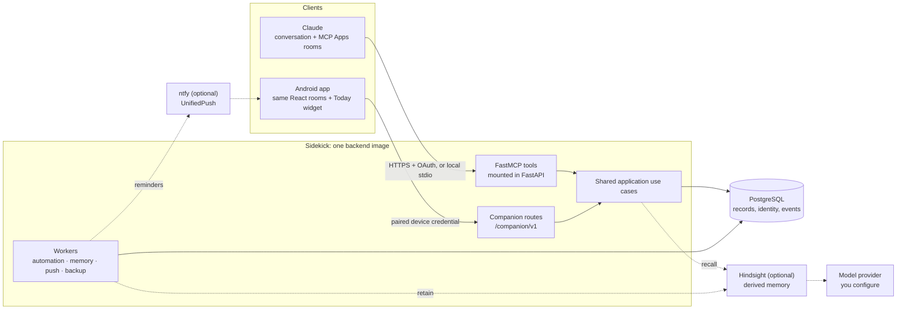

# How the parts fit together

[Svenska](overview.sv.md)

<!-- description: How Sidekick's parts fit together: Claude and the Android app, one server with one set of rules, and your PostgreSQL database as the source of truth. -->

How Sidekick's parts fit together: Claude and the Android app on one side, one server with one set of rules in the middle, and your PostgreSQL database as the source of truth.

- **Claude is the main interface.** It calls a curated set of MCP tools; the rooms (Work, Journal, Contacts,
  Shopping, Control) are MCP Apps that Claude renders in a sandbox and that reach the server only through the
  host bridge. Sidekick has no web frontend of its own. See
  [MCP Apps as Sidekick's product frontend](architecture/mcp-apps.md). Every tool, with its scopes and
  parameters, is listed in the [MCP tool reference](../reference/mcp/index.md).
- **One backend, one set of rules.** FastMCP is mounted inside a FastAPI app. The MCP tools and the Android
  companion routes call the same application use cases, which own authorization, owner filtering, versions and
  idempotency. PostgreSQL holds the authoritative records.
- **The Android app** runs the same React rooms from packaged assets and talks to a closed list of companion
  routes with a paired, revocable device credential, not to the MCP endpoint
  ([ADR-005](../decisions/adr/ADR-005-native-android-app.md)).
- **Workers** are separate processes from the same image: the automation worker turns due recurring processes
  into tasks; the optional memory, push and backup workers keep Hindsight in step, deliver reminders after
  commit and write encrypted owner exports.
- **Memory is derived and rebuildable.** Hindsight is fed from your records, recall is checked against
  current PostgreSQL state, and it never grants authority. Sidekick itself calls no language model; Hindsight
  calls the model provider you configure for it.
