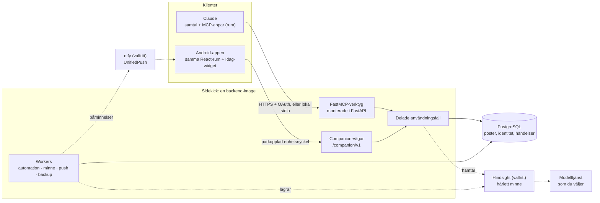

# Så hänger delarna ihop

[English](overview.md)

<!-- description: Så hänger Sidekicks delar ihop: Claude och Android-appen på ena sidan, en server med en uppsättning regler i mitten och din PostgreSQL-databas som det som gäller. -->

Så hänger Sidekicks delar ihop: Claude och Android-appen på ena sidan, en server med en uppsättning regler i mitten och din PostgreSQL-databas som det som gäller.

- **Claude är huvudgränssnittet.** Claude anropar ett kurerat urval MCP-verktyg. Rummen (Arbete, Dagbok,
  Kontakter, Inköp, Kontroll) är MCP-appar som Claude visar i en sandlåda och som bara når servern via värdens
  brygga. Sidekick har inget eget webbgränssnitt. Se
  [MCP Apps as Sidekick's product frontend](architecture/mcp-apps.md) (engelska).
- **En backend, en uppsättning regler.** FastMCP är monterat i en FastAPI-app. MCP-verktygen och Android-appens
  companion-vägar anropar samma användningsfall, som äger behörighet, ägarfiltrering, versioner och
  idempotens. PostgreSQL har de auktoritativa posterna.
- **Android-appen** kör samma React-rum från paketerade filer och pratar med en stängd lista companion-vägar
  med en parkopplad enhetsnyckel som går att återkalla, inte med MCP-ändpunkten
  ([ADR-005](../decisions/adr/ADR-005-native-android-app.md)).
- **Workers** är egna processer från samma image: automationsworkern gör förfallna återkommande processer till
  uppgifter, och de valfria minnes-, push- och backupworkers håller Hindsight i takt, levererar påminnelser
  efter commit och skriver krypterade ägarexporter.
- **Minnet är härlett och går att bygga om.** Hindsight matas från dina poster, det som hämtas kontrolleras mot
  aktuellt läge i PostgreSQL och ger aldrig någon behörighet. Sidekick anropar själv ingen språkmodell; Hindsight
  anropar den modelltjänst du konfigurerar för det.
