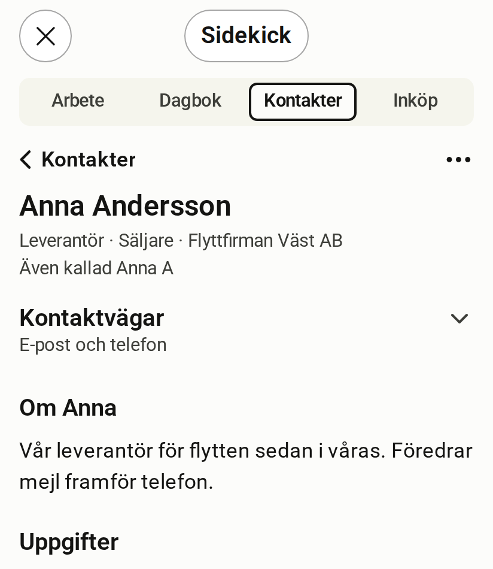

# Contacts

[Svenska](contacts.sv.md)

<!-- description: The Contacts room shows people and organisations in context. How to search, add, edit and link contacts. -->

Contacts (Kontakter) is the room for people and organisations. Each contact is shown together with the tasks, notes and projects that belong to it.

*Simulated host, fictitious data*

## What the room shows

- **The list** of your contacts, with a search field at the top.
- **The contact**: name, one line with relation, role and organisation, and a note about the person.
- **Kontaktvägar** (Contact details), a folded row with email and phone. It only shows when there is something to show.
- **Tasks, Notes and Projects** linked to the contact.

## Find a contact

Type in the search field at the top of the room. The list shows the matches as you type.

## Add a contact

1. Tap + at the top right.
2. Type the name.
3. Press Return.

You fill in the rest afterwards, or ask Claude to.

## Edit a contact

Open the contact, choose ⋯ and then "Redigera" (Edit). You can also tap the name. In the form you also add nicknames under "Smeknamn" (Nicknames), so that Claude finds the right person when you use one, and "Arkivera" (Archive) hides a contact you no longer want to see in the list.

## Open an email address or phone number

Open the contact and tap "Kontaktvägar". A tap on an address or a number hands over to the host, which opens the link.

## Remove a link

Open the contact and choose ⋯. It has one row per link, "Ta bort koppling till …" (Remove link to …). You can undo straight afterwards.

## What you would rather ask Claude for

- Adding a contact with role, organisation and a note in one go.
- Linking a contact to a project or a task.
- Asking who someone is and what you have going on together.

## Scopes the room needs

A scope is a permission that the server checks on every call.

| To | Scopes |
| --- | --- |
| Read | `contacts:read` |
| Add and edit | `contacts:write` |

:::note[Contacts and memory]
If you have turned memory on, contacts can be one of its sources. Email, phone and address are never sent to memory. [Read about Control and memory](control-and-memory.md).
:::
