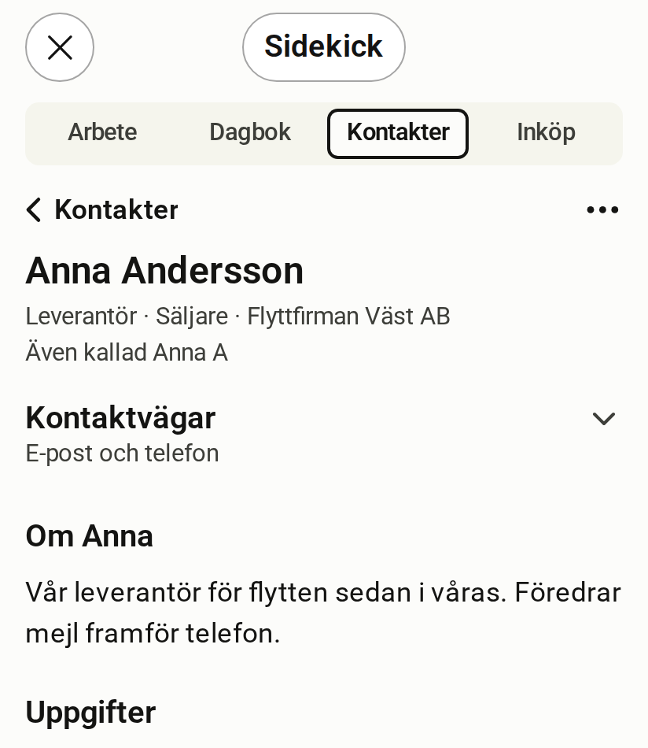

# Kontakter

[English](contacts.md)

<!-- description: Rummet Kontakter visar personer och organisationer i sitt sammanhang. Så söker du, lägger till, ändrar och kopplar kontakter. -->

Kontakter är rummet för personer och organisationer. Varje kontakt visas tillsammans med de uppgifter, anteckningar och projekt som hör till den.

*Simulerad värd, påhittade data*

## Det här visar rummet

- **Listan** med dina kontakter och ett sökfält överst.
- **Kontakten**: namn, en rad med relation, roll och organisation, och en anteckning om personen.
- **Kontaktvägar**, en hopfälld rad med e-post och telefon. Den visas bara när det finns något att visa.
- **Uppgifter, Anteckningar och Projekt** som är kopplade till kontakten.

## Sök en kontakt

Skriv i sökfältet överst i rummet. Listan visar träffarna medan du skriver.

## Lägg till en kontakt

1. Tryck på + uppe till höger.
2. Skriv namnet.
3. Tryck på Retur.

Resten fyller du i efteråt, eller ber Claude om.

## Ändra en kontakt

Öppna kontakten, välj ⋯ och sedan "Redigera". Du kan också trycka på namnet.

## Öppna e-post eller telefon

Öppna kontakten och tryck på "Kontaktvägar". Ett tryck på en adress eller ett nummer lämnar över till värden, som öppnar länken.

## Ta bort en koppling

Öppna kontakten och välj ⋯. Där finns en rad per koppling, "Ta bort koppling till …". Du kan ångra direkt efteråt.

## Det här ber du hellre Claude om

- Lägga till en kontakt med roll, organisation och anteckning i ett svep.
- Lägga till ett smeknamn, så att Claude hittar rätt person när du använder det.
- Koppla en kontakt till ett projekt eller en uppgift.
- Fråga vem någon är och vad ni har på gång.
- Arkivera en kontakt som du inte längre vill se i listan.

## Scopes som rummet behöver

En scope är en behörighet som servern kontrollerar vid varje anrop.

| För att | Scopes |
| --- | --- |
| Läsa | `contacts:read` |
| Lägga till och ändra | `contacts:write` |

:::note[Kontakter och minnet]
Har du slagit på minnet kan kontakter vara en av källorna. E-post, telefon och adress skickas aldrig till minnet. [Läs om Kontroll och minnet](control-and-memory.sv.md).
:::
