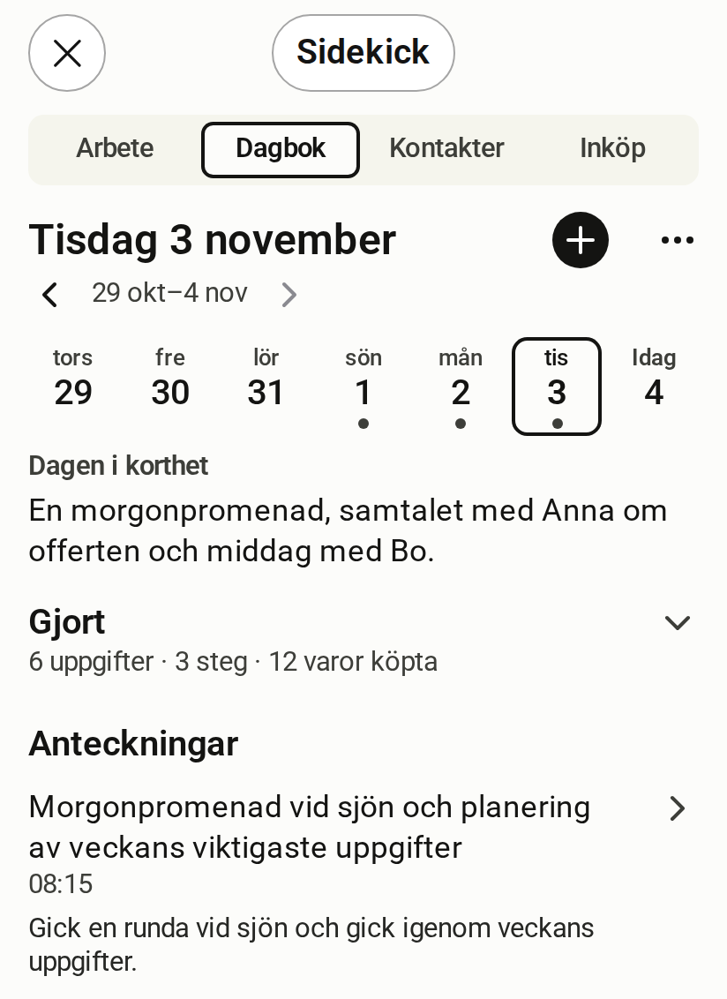

# Journal

[Svenska](journal.sv.md)

<!-- description: The Journal room shows one day at a time with a summary and entries. How to change day, write by hand and let Claude write for you. -->

Journal (Dagbok) is the room for what you want to remember. It shows one day at a time, with several entries per day.

*Simulated host, fictitious data*

## What the room shows

- **The date** as the heading, with a strip for the days of the week below it. A dot under a day means the day has notes.
- **Dagen i korthet** (The day in brief), a summary of the day when there is one.
- **Anteckningar** (Notes), the day's entries.
- **Gjort** (Done), a folded row with what you finished that day: tasks, steps and items bought.

## Change day

Tap a day in the strip. The arrows next to the week step one week at a time. The strip shows no future days.

## Write an entry by hand

1. Tap + next to the date.
2. Write the entry.
3. Save.

What you write by hand does not pass through any AI.

## Edit an entry

Open the entry, choose ⋯ and then "Redigera" (Edit). You can also tap the title.

## Tell Claude about your day

An empty day shows the button "Berätta om dagen" (Tell me about the day). Claude then asks about the day and saves it in the journal. You can also write straight in the conversation, for example "write in my journal that …".

## Review a draft

When an entry has been derived from a source text with the help of AI, it stays a draft. It remains a draft until you have edited it, approved it or rejected it.

## What you would rather ask Claude for

- Writing an entry for you from what you tell it.
- Adding something to today's entry.
- Writing or replacing the summary of a day.
- Linking an entry to a contact or a project.
- Finding what you wrote about a person or a period.
- Tagging entries and finding entries by tag. `list_journal_entries` filters with `tags` and `tag_match` (`any` or `all`); Claude reuses existing tags with `list_tags`, which needs `projects:read` and shows only the kinds of record you may read.

## Scopes the room needs

A scope is a permission that the server checks on every call.

| To | Scopes |
| --- | --- |
| Read | `journal:read` |
| Write and edit | `journal:write` |

The example configuration does not give Claude access to the journal. You add it yourself. [Read how to change what the session may do](../operate/connect-claude.md).

:::caution[Claude reads the journal text]
With `journal:read` Claude can read your entries, including the text itself. What Claude reads leaves your server and is shared with Claude. [Read who sees what](../explanation/security-and-privacy.md).
:::
