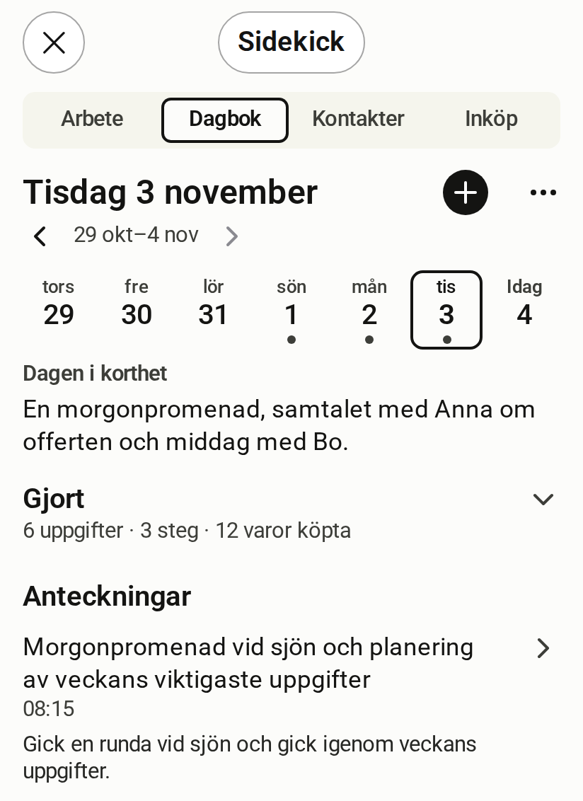

# Dagbok

[English](journal.md)

<!-- description: Rummet Dagbok visar en dag i taget med sammanfattning och inlägg. Så byter du dag, skriver för hand och låter Claude skriva åt dig. -->

Dagbok är rummet för det du vill minnas. Det visar en dag i taget, med flera inlägg per dag.

*Simulerad värd, påhittade data*

## Det här visar rummet

- **Datumet** som rubrik, med en remsa för veckans dagar under. En prick under en dag betyder att dagen har anteckningar.
- **Dagen i korthet**, en sammanfattning av dagen när det finns en.
- **Anteckningar**, dagens inlägg.
- **Gjort**, en hopfälld rad med det du blev klar med den dagen: uppgifter, steg och köpta varor.

## Byt dag

Tryck på en dag i remsan. Pilarna bredvid veckan stegar en vecka i taget. Remsan visar inga framtida dagar.

## Skriv ett inlägg för hand

1. Tryck på + bredvid datumet.
2. Skriv inlägget.
3. Spara.

Det du skriver för hand går inte genom någon AI.

## Ändra ett inlägg

Öppna inlägget, välj ⋯ och sedan "Redigera". Du kan också trycka på titeln.

## Berätta om dagen för Claude

En tom dag visar knappen "Berätta om dagen". Då frågar Claude om dagen och sparar det i dagboken. Du kan också skriva direkt i samtalet, till exempel "skriv i dagboken att …".

## Granska ett utkast

När ett inlägg har tagits fram ur en källtext med hjälp av AI stannar det som utkast. Det förblir ett utkast tills du har ändrat det, godkänt det eller avvisat det.

## Det här ber du hellre Claude om

- Skriva ett inlägg åt dig utifrån det du berättar.
- Lägga till något i dagens inlägg.
- Skriva eller byta ut sammanfattningen av en dag.
- Koppla ett inlägg till en kontakt eller ett projekt.
- Tagga inlägg och hitta inlägg efter tagg. `list_journal_entries` filtrerar med `tags` och `tag_match` (`any` eller `all`); Claude återanvänder befintliga taggar med `list_tags`, som kräver `projects:read` och bara visar de sorters poster du får läsa.

## Scopes som rummet behöver

En scope är en behörighet som servern kontrollerar vid varje anrop.

| För att | Scopes |
| --- | --- |
| Läsa | `journal:read` |
| Skriva och ändra | `journal:write` |

Exempelkonfigurationen ger inte Claude tillgång till dagboken. Du lägger till den själv. [Läs hur du ändrar vad sessionen får göra](../operate/connect-claude.sv.md).

:::caution[Claude läser dagbokstexten]
Med `journal:read` kan Claude läsa dina inlägg, också själva texten. Det Claude läser lämnar din server och delas med Claude. [Läs vem som ser vad](../explanation/security-and-privacy.sv.md).
:::
