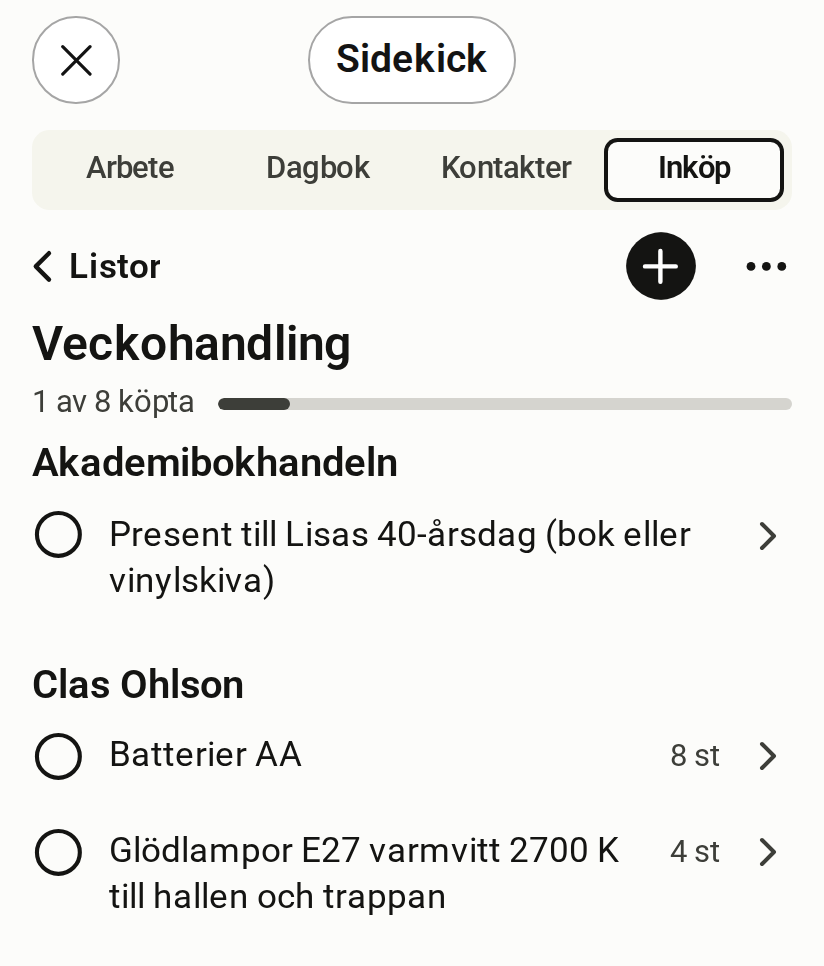

# Shopping

[Svenska](shopping.sv.md)

<!-- description: The Shopping room shows a list grouped by store. How to add items, tick off what you bought, undo and change quantities. -->

Shopping (Inköp) is the room for shopping lists. A list shows the items grouped by store and how much you have bought.

*Simulated host, fictitious data*

## What the room shows

- **How far you have come**, for example "1 av 8 köpta" (1 of 8 bought).
- **The items** grouped by store, with quantity and unit.
- **Köpta** (Bought), a folded row with what you have already ticked off.

## Add an item

1. Tap "+ Lägg till vara" (Add item) at the top of the list.
2. Type the item.
3. Press Return. The field stays open, so you can type the next one straight away.

## Tick off what you bought

Tap the ring in front of the item. The item moves to Bought.

## Undo a purchase

Tap "Ångra" (Undo) on the row right after you ticked it off. Later, open Bought and tap the ring again.

## Change quantity or store

Tap the item's row, next to the ring. This opens the item's form, where you change the name, quantity and store.

## What you would rather ask Claude for

- Creating a new list.
- Adding many items at once, for example from a recipe.
- Marking everything you bought in one store as bought.
- Renaming a list or archiving it.

## Shopping in the Android app

The Android app shows the same lists. There you can add, edit, tick off and undo. [Read about the Android app](android-app.md).

## Scopes the room needs

A scope is a permission that the server checks on every call.

| To | Scopes |
| --- | --- |
| Read | `shopping:read` |
| Add, edit and tick off | `shopping:write` |
