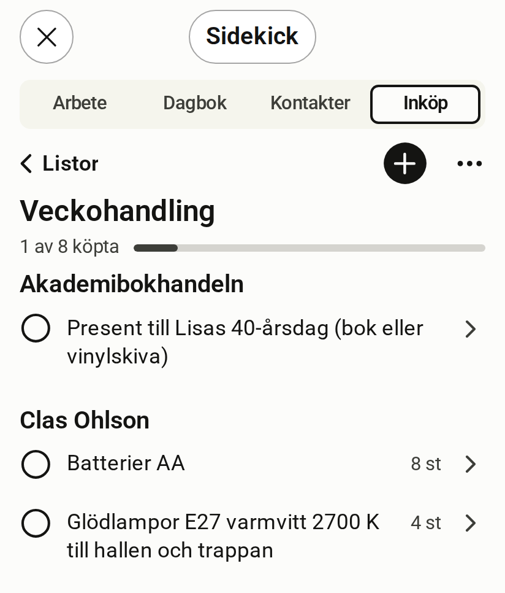

# Inköp

[English](shopping.md)

<!-- description: Rummet Inköp visar en lista grupperad per butik. Så lägger du till varor, bockar av det du köpt, ångrar och ändrar antal. -->

Inköp är rummet för inköpslistor. En lista visar varorna grupperade per butik och hur mycket du har köpt.

*Simulerad värd, påhittade data*

## Det här visar rummet

- **Hur långt du har kommit**, till exempel "1 av 8 köpta".
- **Varorna** grupperade per butik, med antal och enhet.
- **Köpta**, en hopfälld rad med det du har bockat av. Siffran räknar varorna vars "Ångra"-tid har gått ut, så den ändras inte medan "Ångra" erbjuds. Framstegsraden räknar alla köpta varor.

## Lägg till en vara

1. Tryck på "+ Lägg till vara" överst i listan.
2. Skriv varan.
3. Tryck på Retur. Fältet är kvar, så du kan skriva nästa direkt.

## Bocka av det du köpt

Tryck på ringen framför varan. Varan ligger kvar bland de öppna en kort stund med "Ångra" och flyttas sedan till Köpta. Under Köpta visar varje vara dagen den köptes ("köpt …"), och den senast köpta kommer först.

## Ångra ett köp

Tryck på "Ångra" på raden direkt efter att du bockat av. Senare öppnar du Köpta och trycker på ringen igen. I helskärm står ett tips ovanför de köpta varorna, "Tryck på ringen för att köpa igen.", tills du har köpt en vara igen en gång.

## Ändra antal eller butik

Tryck på varans rad, bredvid ringen. Då öppnas varans formulär, där du ändrar namn, antal och butik. Under "Fler fält" finns resten, till exempel anteckning, erbjudande och presentmottagare. Erbjudandet har en egen hopfällbar del där. Stängd säger den vad som är sparat, till exempel "Erbjudande: 199 kr t.o.m. 30 nov". Öppna den för att ändra "Erbjudandepris" och de andra erbjudandefälten. Priser skrivs i appens språk: med decimalkomma på svenska och decimalpunkt på engelska. Ett pris som inte är ett tal får "Ange ett pris som 19,90." (svenska) eller "Enter a price like 19.90." (engelska).

## Markera en vara som present

Under "Fler fält" kopplar "Presentmottagare (valfritt)" varan till en av dina kontakter. Sök fram kontakten med "Sök kontakt" och välj den. Formuläret visar mottagarens namn när sessionen får läsa kontakter (`contacts:read`), annars står det "Nuvarande mottagare". Sökningen kräver rummet Kontakter och finns inte i Android-appen, som behåller en mottagare som redan är satt.

## Skapa, byt namn på eller arkivera en lista

Tryck på + bredvid Listor för att skapa en ny lista. I helskärm byter du namn på listan med ⋯ och "Redigera lista", och "Arkivera lista" arkiverar den. Arkiverade listor står sist bland listorna, i en hopfälld rad "Arkiverade (N)" som du öppnar för att se dem.

## Kortet i chatten

I chatten visas listan som ett kort med de första varorna. När kortet utelämnar några säger knappen "Öppna inköpslistan" hur många, till exempel "Öppna inköpslistan · 2 fler".

## Det här ber du hellre Claude om

- Lägga till många varor på en gång, till exempel från ett recept.
- Markera allt du köpte i en butik som köpt.

## Inköp i Android-appen

Android-appen visar samma listor. Där kan du skapa listor, lägga till, ändra, bocka av och ångra. [Läs om Android-appen](android-app.sv.md).

## Scopes som rummet behöver

En scope är en behörighet som servern kontrollerar vid varje anrop.

| För att | Scopes |
| --- | --- |
| Läsa | `shopping:read` |
| Lägga till, ändra och bocka av | `shopping:write` |
| Hitta och visa namnet på en presentmottagare | dessutom `contacts:read` |
