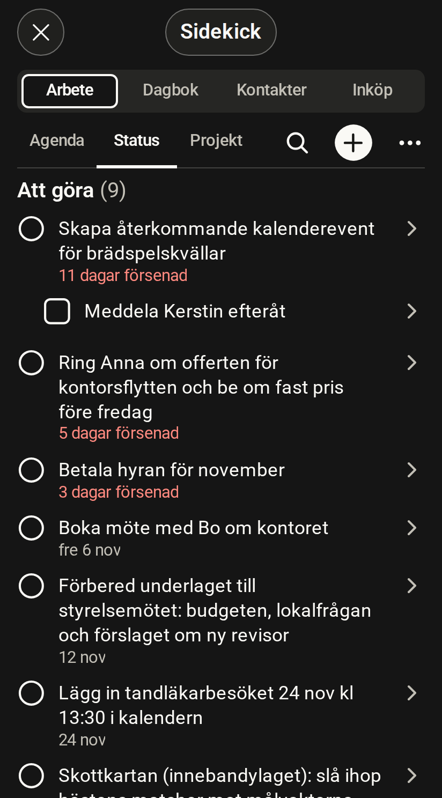

# Work

[Svenska](work.sv.md)

<!-- description: The Work room shows an agenda, a status board and projects. How to create tasks, check them off, change dates and split them into steps. -->

Work (Arbete) is the room for tasks and projects. It has three tabs: Agenda, Status and Projects (Projekt).

*Simulated host, fictitious data*

## What the room shows

- **Agenda** shows tasks with dates: overdue, today, upcoming and later.
- **Status** shows the tasks grouped by state: To do, In progress, Blocked and Done.
- **Projects** shows your projects and the tasks in them.

## Create a task

1. Tap + at the top right.
2. Type the task.
3. Press Return. The field stays open, so you can type the next one straight away.

## Check off a task

Tap the ring in front of the task. The row stays for a short while with an "Ångra" (Undo) button, in case you tapped by mistake.

## Change status or date

1. Press and hold a task in the list. On a computer, right-click or press Shift+F10.
2. Choose a new status, or a date: today, tomorrow, next week or a day you pick.

You can also open the task and tap the date or the status under the title.

## Move overdue tasks to tomorrow

When the agenda has overdue tasks, the row "Flytta … försenade till imorgon" (Move … overdue to tomorrow) sits under the Overdue heading. One tap moves them all at once.

## Split a task into steps

1. Open the task.
2. Tap "+ Lägg till steg" (Add step).
3. Type the step and press Return.

You check steps off inside the task, one at a time.

## Edit a task, its place or how it repeats

Open the task and choose ⋯ and then "Redigera" (Edit) to change the title, description, priority and date. You can also tap the title. Under the title, the chip "Plats" (Place) moves the task to a project, process or domain, and the repeat chip makes it repeat every day, week, month or year.

## Link a contact to a task

Open the task and tap "+ Koppla kontakt" (Link contact). The link then shows both in the task and on the contact.

## What you would rather ask Claude for

- Creating several tasks at once, for example from a list or a photo of a whiteboard.
- Setting up projects, domains and processes.
- Repeating on given weekdays or at other intervals.
- Setting tags and time estimates.
- Moving many tasks to a given date.
- Finding a task when you only remember roughly what it was about.

## Scopes the room needs

A scope is a permission that the server checks on every call.

| To | Scopes |
| --- | --- |
| Read | `tasks:read`, `projects:read` |
| Change tasks and steps | `tasks:write` |
| Change projects and domains | `projects:write` |

Every tool and its scopes are listed in the [MCP tool reference](../reference/mcp/index.md).
