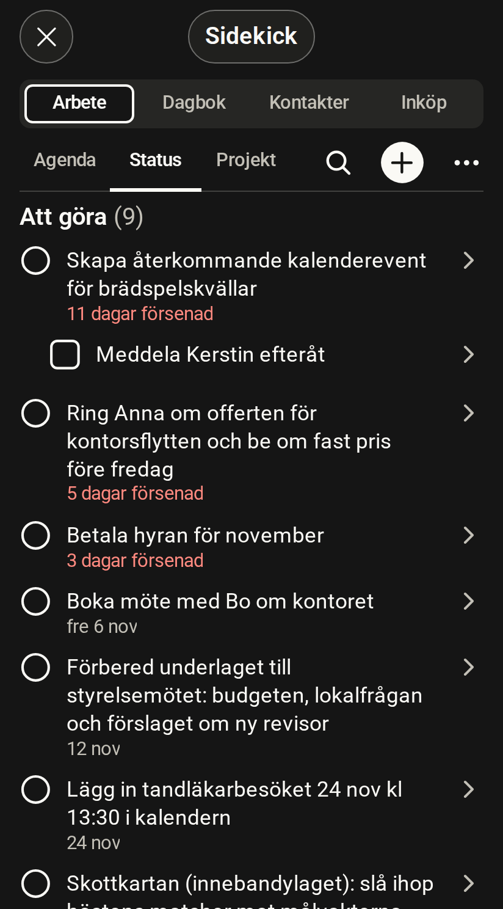

# Arbete

[English](work.md)

<!-- description: Rummet Arbete visar agenda, statustavla och projekt. Så skapar du uppgifter, bockar av, byter datum och delar upp i steg. -->

Arbete är rummet för uppgifter och projekt. Det har tre flikar: Agenda, Status och Projekt.

*Simulerad värd, påhittade data*

## Det här visar rummet

- **Agenda** visar uppgifter med datum: försenade, idag, kommande och senare.
- **Status** visar uppgifterna grupperade efter läge: Att göra, Pågår, Blockerad och Klar.
- **Projekt** visar dina projekt och uppgifterna i dem.

## Skapa en uppgift

1. Tryck på + uppe till höger.
2. Skriv uppgiften.
3. Tryck på Retur. Fältet är kvar, så du kan skriva nästa direkt.

## Bocka av en uppgift

Tryck på ringen framför uppgiften. Raden ligger kvar en kort stund med knappen "Ångra", ifall du tryckte fel.

## Byt status eller datum

1. Håll inne en uppgift i listan. På dator högerklickar du eller trycker Shift+F10.
2. Välj ny status, eller ett datum: idag, imorgon, nästa vecka eller en dag du väljer.

Du kan också öppna uppgiften och trycka på datumet eller statusen under titeln.

## Flytta försenade uppgifter till imorgon

När agendan har försenade uppgifter finns raden "Flytta … försenade till imorgon" under rubriken Försenade. Ett tryck flyttar alla på en gång.

## Dela upp en uppgift i steg

1. Öppna uppgiften.
2. Tryck på "+ Lägg till steg".
3. Skriv steget och tryck på Retur.

Steg bockar du av i uppgiften, ett i taget.

## Koppla en kontakt till en uppgift

Öppna uppgiften och tryck på "+ Koppla kontakt". Kopplingen syns sedan både i uppgiften och hos kontakten.

## Det här ber du hellre Claude om

- Skapa flera uppgifter på en gång, till exempel från en lista eller ett foto av en whiteboard.
- Lägga upp projekt, områden och återkommande arbete.
- Sätta prioritet, taggar och tidsuppskattningar.
- Flytta många uppgifter till ett visst datum.
- Hitta en uppgift när du bara minns ungefär vad den handlade om.

## Scopes som rummet behöver

En scope är en behörighet som servern kontrollerar vid varje anrop.

| För att | Scopes |
| --- | --- |
| Läsa | `tasks:read`, `projects:read` |
| Ändra uppgifter och steg | `tasks:write` |
| Ändra projekt och områden | `projects:write` |

Alla verktyg och deras scopes står i [MCP-verktygsreferensen](../reference/mcp/index.md), som är på engelska.
